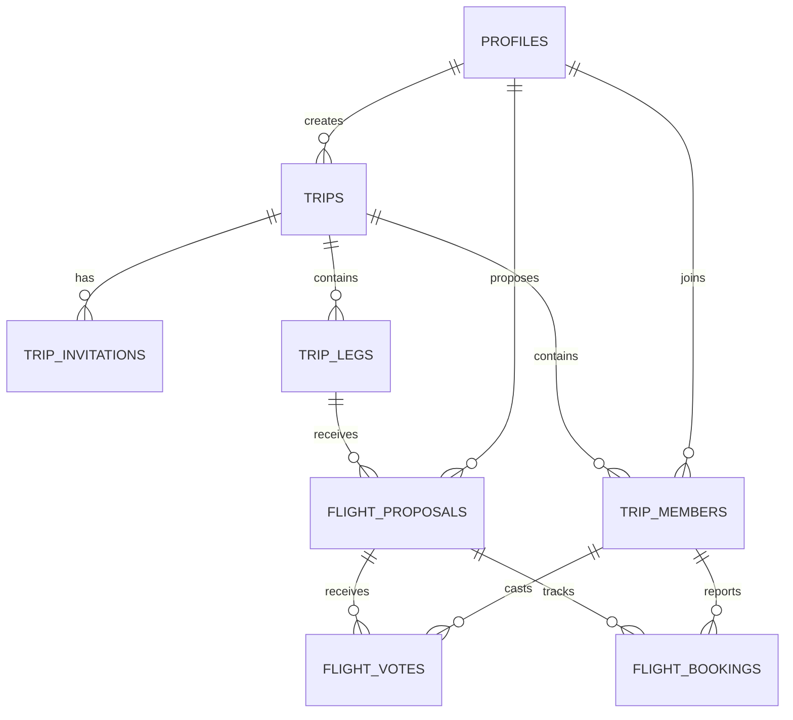

Sure, I'll get that written out for you.

# triply — MVP Development Plan

**Project:** triply — Collaborative Group Flight Planner  
**Status:** Wireframes complete; ready for development  
**Design:** [Figma Wireframes](https://www.figma.com/design/2HViNFR9Qmm1jSBDBcQ6F8)  
**Platform:** Mobile-first web application  
**Tech Stack:** Next.js, TypeScript, Tailwind CSS, Supabase  
**Estimated MVP Timeline:** 3–5 weeks of part-time development

---

## 1. Project Overview

### What is triply?

triply is a collaborative flight-planning application designed for groups of friends organizing trips together.

Instead of coordinating flights through scattered text messages, screenshots, and spreadsheets, travelers can use a shared workspace to:

1. Create a trip and invite friends.
2. Organize the trip into travel legs.
3. Propose flights for each leg.
4. Compare flight options.
5. Express interest and vote on flights.
6. Agree on a flight as a group.
7. Book tickets individually through external websites.
8. Track who has completed their bookings.

### MVP philosophy

The goal is to build the **smallest functional version of triply that supports an entire group flight-planning experience**.

We are not building a flight-booking platform.

For the MVP:

- Users manually enter flight information.
- Flight proposals can include external booking links.
- Users book directly through airlines or travel websites.
- triply tracks planning decisions and self-reported booking statuses.
- Flight prices and availability are not automatically updated.

Advanced flight search, price monitoring, and AI-powered recommendations can be added later.

---

# Phase 1: Project Foundation

**Estimated duration:** 4–7 development days

**Objective:** Establish the application architecture, database, authentication, and reusable UI system.

At the end of this phase, we should have a running application with authentication, a working database, and the basic visual structure from Figma.

## Step 1.1 — Initialize the Next.js project

Create a new Next.js application using:

- Next.js with App Router
- TypeScript
- Tailwind CSS
- ESLint
- Yarn

Suggested initialization:

```bash
yarn create next-app triply
cd triply
yarn dev
```

Use the `src/` directory structure and App Router.

### Suggested project structure

```text
triply/
├── public/
│   ├── images/
│   └── airlines/
│
├── src/
│   ├── app/
│   │   ├── (auth)/
│   │   │   ├── login/
│   │   │   └── signup/
│   │   │
│   │   ├── (app)/
│   │   │   ├── trips/
│   │   │   │   ├── page.tsx
│   │   │   │   └── [tripId]/
│   │   │   │       ├── page.tsx
│   │   │   │       ├── flights/
│   │   │   │       └── group/
│   │   │   │
│   │   │   └── settings/
│   │   │
│   │   ├── invite/
│   │   │   └── [token]/
│   │   │
│   │   ├── layout.tsx
│   │   └── globals.css
│   │
│   ├── components/
│   │   ├── ui/
│   │   ├── layout/
│   │   ├── trips/
│   │   ├── flights/
│   │   └── group/
│   │
│   ├── lib/
│   │   ├── supabase/
│   │   ├── auth/
│   │   └── utils/
│   │
│   ├── types/
│   └── hooks/
│
├── supabase/
│   └── migrations/
│
├── .env.local
└── package.json
```

This organization separates application routes, reusable components, and backend integration.

### Deliverables

- Next.js application initialized.
- Development server running locally.
- Git repository initialized.
- Initial commit created.
- Environment variables configured.

**Completion criterion:** The application runs locally without errors.

---

## Step 1.2 — Configure Supabase

Supabase will provide:

- PostgreSQL database
- User authentication
- Database security
- Server-side data access
- Optional real-time subscriptions

### Tasks

1. Create a Supabase project.
2. Install the Supabase JavaScript and SSR packages.
3. Configure browser and server clients.
4. Add environment variables.
5. Establish the migration workflow.
6. Configure Row Level Security policies.

Example environment variables:

```env
NEXT_PUBLIC_SUPABASE_URL=
NEXT_PUBLIC_SUPABASE_PUBLISHABLE_KEY=
```

Never expose a Supabase secret or service-role key to client-side code.

### Deliverables

- Next.js connected to Supabase.
- Database migrations configured.
- Authentication client configured.
- Secure server-side database access.

---

## Step 1.3 — Design the database schema

This is one of the most important architectural decisions.

We should model the different aspects of group flight planning separately.

### Core database tables

| Table | Purpose |
|---|---|
| `profiles` | User profile information |
| `trips` | Trip information |
| `trip_members` | Users belonging to trips |
| `trip_invitations` | Invitation links and tokens |
| `trip_legs` | Individual travel segments |
| `flight_proposals` | Suggested flights for a travel leg |
| `flight_votes` | Individual votes on proposed flights |
| `flight_bookings` | Individual booking statuses |

### Relationships



### Important schema decisions

**Trips**

Each trip should contain:

- ID
- Name
- Description
- Start date
- End date
- Creator ID
- Created timestamp

**Trip members**

Each member should have a role:

- `organizer`
- `member`

The organizer manages the trip and makes the final flight-selection decision.

**Trip legs**

Each travel leg should contain:

- Origin
- Destination
- Travel date
- Order within the trip
- Selected flight proposal, if any

For example:

```text
Trip: Europe Winter Trip

Leg 1: Barcelona → Lisbon
Leg 2: Lisbon → Berlin
Leg 3: Berlin → Home
```

For travelers departing from different cities, the data model should eventually support traveler-specific legs. For the first implementation, shared trip legs are sufficient, provided the schema does not assume every traveler must use every leg.

**Flight proposals**

Each proposal should contain:

- Airline
- Flight number
- Origin airport
- Destination airport
- Departure datetime
- Arrival datetime
- Price
- Currency
- Booking URL
- Proposer ID
- Trip leg ID

Store departure and arrival as timezone-aware instants, and retain the airports' time zones for local display.

**Flight votes**

For the MVP, each member can vote for one proposal per trip leg.

A member should be able to change their vote.

**Flight bookings**

Track:

- Member
- Selected flight
- Booking status
- Last updated timestamp

Suggested statuses:

```text
not_decided
planning_to_book
booked
not_joining
```

Booking statuses are self-reported. We do not need to verify airline purchases.

### Security requirements

Enable Row Level Security for all user-facing tables.

At minimum:

- Users can view trips they belong to.
- Only members can propose flights.
- Members can modify only their own votes.
- Members can modify only their own booking statuses.
- Only organizers can select the final flight.
- Invitation acceptance must validate the invitation token.

These rules must be enforced in the database or trusted server-side operations, not just through hidden UI buttons.

### Deliverables

- Database schema.
- Initial SQL migrations.
- Foreign-key relationships.
- Appropriate uniqueness constraints.
- Row Level Security policies.
- Generated TypeScript database types.

**Completion criterion:** We can create a trip, associate members, and store flight proposals in Supabase.

---

## Step 1.4 — Implement authentication

Use Supabase Auth.

### MVP authentication methods

Start with:

- Email authentication
- Google OAuth, if configuration is straightforward

Avoid building custom password-management infrastructure.

### Required screens

1. Login
2. Signup
3. Authentication callback
4. Basic profile/settings

### Authentication behavior

When an unauthenticated user opens a protected trip page:

1. Redirect to login.
2. Authenticate.
3. Return the user to their intended destination.

This is especially important for invitation links.

### Deliverables

- Functional login/signup.
- Persistent sessions.
- Protected routes.
- Logout functionality.
- Automatic profile creation.

**Completion criterion:** Users can securely sign in and access their own account.

---

## Step 1.5 — Implement the design system

Use the existing Figma wireframes as the visual reference.

### Design principles

- Mobile-first
- Dark mode by default
- Rounded cards
- Consistent spacing
- Clear typography hierarchy
- Contextual buttons
- Compact bottom navigation

### Core components

Build reusable components for:

```text
Button
Card
Input
Select
Modal
Badge
Avatar
BottomNavigation
PageHeader
EmptyState
LoadingState
ErrorMessage
```

### Design tokens

Define reusable colors for:

- Background
- Card surface
- Elevated surface
- Primary text
- Secondary text
- Primary accent
- Success
- Warning
- Border

Avoid hardcoding slightly different shades across components.

### Deliverables

- Global styling.
- Dark-theme tokens.
- Reusable components.
- Responsive layout.
- Bottom navigation.

**Completion criterion:** The basic Figma visual system is represented in reusable React components.

---

# Phase 2: Core Group Planning Experience

**Estimated duration:** 6–10 development days

**Objective:** Implement the complete collaborative flight-planning workflow.

At the end of this phase, users should be able to create trips, invite friends, propose flights, vote, and select a flight.

## Step 2.1 — Build the Trips Home screen

**Figma reference:** Frame 01

### Features

- Display trips the user belongs to.
- Show trip name and dates.
- Display trip status.
- Open an existing trip.
- Create a new trip.

### Empty state

When a user has no trips:

> No trips yet. Create your first trip and start planning together.

### Deliverables

- Trips list.
- Create Trip button.
- Empty state.
- Loading state.
- Navigation to trip dashboard.

---

## Step 2.2 — Implement trip creation

Create a trip form with:

- Trip name
- Start date
- End date
- Optional description

### Workflow

```text
Trips Home
    ↓
Create Trip
    ↓
Enter Details
    ↓
Save Trip
    ↓
Trip Dashboard
```

The creator automatically becomes the organizer.

### Validation

- Trip name is required.
- End date cannot precede start date.
- Dates must be valid.

### Deliverables

- Trip creation form.
- Database insert.
- Organizer membership creation.
- Redirect to new trip.

**Completion criterion:** A user can create a trip and see it on their dashboard.

---

## Step 2.3 — Implement trip invitations

Users should be able to invite friends using a shareable link.

Example:

```text
triply.app/invite/abc123
```

### Invitation flow

```text
Organizer creates invitation
          ↓
Shares invitation URL
          ↓
Friend opens URL
          ↓
Login / Signup if necessary
          ↓
Friend accepts invitation
          ↓
Friend joins trip
          ↓
Trip dashboard
```

### Important details

- Invitations should use unpredictable tokens.
- Tokens should support expiration or revocation.
- Existing members should not be added twice.
- Expired invitations should show an appropriate error.
- Invitation acceptance should be safe against duplicate submissions.

### Deliverables

- Generate invitation link.
- Copy/share link.
- Invitation landing page.
- Join-trip functionality.
- Group member list.

**Completion criterion:** Two separate user accounts can join the same trip.

---

## Step 2.4 — Build the Trip Dashboard

**Implemented:** See [dashboard behavior and verification](dashboard.md).

**Figma reference:** Frame 02

The dashboard provides an overview of the trip.

### Display

- Trip name
- Dates
- Destinations
- Members
- Travel legs
- Planning progress
- Booking progress

### Travel leg statuses

Each leg can be:

**Needs options:** No flights proposed.

**Decision pending:** One or more proposals exist, but no flight is selected.

**Flight selected:** The organizer has selected a flight.

**Booking underway:** A flight is selected and members are reporting bookings.

These can be computed from the underlying records rather than stored as independent status fields.

### Deliverables

- Dashboard layout.
- Trip summary.
- Travel leg cards.
- Status indicators.
- Navigation to flight proposals.

---

## Step 2.5 — Implement travel legs

A trip can have multiple travel segments.

For example:

```text
Barcelona → Lisbon
Lisbon → Berlin
Berlin → Atlanta
```

### Features

- Add travel leg.
- Specify origin.
- Specify destination.
- Specify travel date.
- Reorder legs.
- View proposals associated with each leg.

### MVP simplification

Use airport codes where available.

For example:

```text
BCN — Barcelona
LIS — Lisbon
BER — Berlin
```

Airport names and country flags can be derived from a small airport metadata dataset.

### Deliverables

- Create travel leg.
- Display travel legs.
- Edit leg details.
- Link legs to proposals.

**Completion criterion:** A trip can contain multiple ordered travel legs.

---

## Step 2.6 — Implement flight proposals

**Figma references:** Frames 03, 04, 05, and 06

This is the central feature of triply.

### Flight proposal workflow

```text
Trip Dashboard
       ↓
Select Travel Leg
       ↓
View Flight Proposals
       ↓
Add Flight
       ↓
Enter Flight Details
       ↓
Save Proposal
       ↓
Proposal Appears in Group List
```

### MVP input method

Implement manual entry first.

Required fields:

- Airline
- Origin airport
- Destination airport
- Departure date and time
- Arrival date and time

Optional fields:

- Flight number
- Price
- Booking URL
- Notes

The existing Figma screen offers three entry methods:

1. Paste booking link.
2. Enter airline and flight number.
3. Enter manually.

For the first release, only manual entry should be functional. The other methods should be visibly labeled as coming soon or hidden until implemented.

### Flight card display

Each flight card should show:

```text
Vueling

🇪🇸 BCN → 🇵🇹 LIS

09:30 → 10:25

€89

3 interested
```

Use 24-hour time consistently.

Display local departure and arrival times.

### Airline logos

Use official airline logos when suitable assets are available.

Until then, use consistent airline-name text fallbacks rather than inaccurate branding.

### Deliverables

- Flight proposal form.
- Proposal list.
- Proposal details.
- Basic validation.
- Booking URL support.
- Airline display component.

**Completion criterion:** Members can add flights and see proposals submitted by other members.

---

## Step 2.7 — Implement voting and group decisions

**Figma reference:** Frame 07

Members should be able to indicate their preferred flight.

### MVP voting rules

I recommend the following:

1. Each member gets one active vote per travel leg.
2. Members can change their votes.
3. The interface displays vote totals.
4. The organizer makes the final selection.
5. Selecting a flight closes voting for that leg.

This avoids requiring unanimous agreement while preserving group input.

### Example

```text
Barcelona → Lisbon

Vueling
3 votes
75% support

Ryanair
1 vote
25% support
```

The percentages should be calculated against eligible voting members, with the number of votes cast also shown. That way, abstentions are not mistaken for support.

### Organizer actions

- View voting results.
- Select a flight.
- Confirm the selection.

### Member actions

- Vote.
- Change vote before selection.
- View results.

### Important edge cases

- A user changes their vote.
- A user leaves the trip.
- A proposal is removed.
- Two flights receive equal votes.
- The organizer selects a flight that did not receive the most votes.

The last case is acceptable under the proposed MVP rules, but the selection should be visible to everyone.

### Deliverables

- Vote submission.
- Vote updates.
- Vote counts.
- Percentage indicators.
- Organizer-only selection.
- Selected-flight status.

**Completion criterion:** A group can compare proposals and formally select one flight for a travel leg.

---

# Phase 3: Booking Coordination and MVP Polish

**Estimated duration:** 4–7 development days

**Objective:** Complete the experience after a flight has been selected.

At the end of this phase, groups should be able to coordinate individual bookings and track overall progress.

## Step 3.1 — Implement the Selected Flight screen

**Figma reference:** Frame 08

Once a flight is selected, it becomes the primary option for that travel leg.

### Display

- Airline
- Flight number
- Origin and destination
- Departure and arrival times
- Date
- Price entered when proposed
- External booking link
- Group booking progress

### Booking CTA

Use a clear action:

**Book on airline site ↗**

The button opens the provided booking URL.

Important: the link may point to a general flight-search result or booking page. triply should not imply that the original price or seat availability is guaranteed.

### Deliverables

- Selected flight card.
- Booking URL button.
- Group progress display.

---

## Step 3.2 — Implement individual booking statuses

Each member should manage their own booking status.

### Status options

| Status | Meaning |
|---|---|
| Not decided | No booking commitment |
| Planning to book | Intends to purchase |
| Booked | Reports having purchased a ticket |
| Not joining | Will not take this flight |

### Workflow

```text
Selected Flight
       ↓
Member Opens Booking Link
       ↓
Books Externally
       ↓
Returns to triply
       ↓
Marks Flight as Booked
       ↓
Group Progress Updates
```

### Important distinction

A member marking a flight as booked does not mean triply has verified the purchase.

The MVP is a coordination tool, not a booking-verification service.

### Deliverables

- Status selector.
- Status persistence.
- Member-specific booking records.
- Status updates.

**Completion criterion:** Each member can independently report their booking progress.

---

## Step 3.3 — Implement group booking progress

Display progress for the selected flight.

Example:

```text
Booking Progress

2 of 4 travelers booked

Alex      ✓ Booked
Sam       ✓ Booked
Jordan    ◌ Planning to book
Taylor    ○ Not decided
```

### Progress calculation

```text
Booked members / Participating members
```

Members marked as not joining should be excluded from the participating denominator, with their status still visible.

### Deliverables

- Booking progress indicator.
- Member status list.
- Automatic progress updates.
- Trip-level booking summary.

---

## Step 3.4 — Add loading, empty, and error states

These states are essential for a usable application.

### Empty states

Examples:

- No trips created.
- No travel legs added.
- No flight proposals submitted.
- No votes received.
- No flight selected.

### Loading states

Examples:

- Loading trip details.
- Fetching proposals.
- Saving a vote.
- Updating booking status.

### Error states

Examples:

- Invalid invitation link.
- Network request failure.
- Invalid flight information.
- Unauthorized action.
- Failed booking-status update.

### Deliverables

- Consistent loading indicators.
- Empty-state components.
- Error messages.
- Retry actions where appropriate.

---

## Step 3.5 — Test the complete user journey

Test the application using multiple accounts.

### End-to-end test scenario

**Scenario: Four friends planning a European trip**

1. Alex creates a trip called Europe Winter Trip.
2. Alex invites Sam, Jordan, and Taylor.
3. All four users join.
4. Alex adds the Barcelona-to-Lisbon travel leg.
5. Sam proposes a Vueling flight.
6. Jordan proposes a Ryanair flight.
7. Members vote on their preferred flights.
8. The organizer selects Vueling.
9. Alex and Sam book externally.
10. Alex and Sam mark their statuses as booked.
11. Jordan marks planning to book.
12. Taylor remains undecided.
13. The dashboard displays two of four travelers booked.

### Additional tests

Verify:

- Users cannot access trips they do not belong to.
- Members cannot modify other members' votes.
- Only organizers can select flights.
- Invalid invitation links fail safely.
- Duplicate memberships are prevented.
- Votes update correctly.
- Booking progress calculates correctly.
- Mobile layouts remain usable.

### Deliverables

- Unit tests for business logic.
- Integration tests for database operations.
- End-to-end tests for the primary workflow.
- Basic accessibility testing.
- Mobile browser testing.

---

## Step 3.6 — Deploy the MVP

### Recommended deployment

**Frontend:** Vercel  
**Backend and database:** Supabase

### Tasks

1. Push code to GitHub.
2. Connect the repository to Vercel.
3. Configure production environment variables.
4. Apply database migrations.
5. Configure production authentication redirect URLs.
6. Test invitation links.
7. Verify database security policies.
8. Run final production smoke tests.

### Deliverables

- Publicly accessible application.
- Production Supabase database.
- Working authentication.
- Functional invitation links.
- End-to-end flight-planning experience.

**Completion criterion:** A small group of friends can use triply to coordinate a real trip.

---

# Phase 4: Post-MVP Enhancements

**Not required for the initial launch**

These features can be considered after testing the MVP with real users.

| Feature | Priority | Description |
|---|---|---|
| Flight lookup | High | Retrieve flight information using airline and flight number |
| Booking URL parsing | High | Extract flight details from supported booking links |
| Flight price monitoring | Medium | Notify users about significant price changes |
| Light/dark theme toggle | Medium | Allow users to choose their preferred theme |
| Notifications | Medium | Notify members about proposals and selections |
| Comments | Medium | Discuss specific flight options |
| Airline logo integration | Low | Replace remaining placeholders with verified assets |
| AI flight recommendations | Low | Suggest options based on group preferences |
| Calendar integration | Low | Add selected flights to personal calendars |
| Multi-origin planning | High | Support travelers departing from different cities |

Multi-origin planning is particularly relevant to triply's long-term vision. The MVP schema should leave room for it, even if the first interface focuses on shared travel legs.

---

# Recommended Development Order

Here's the order I'd follow when we begin coding.

| Order | Task | Phase |
|---|---|---|
| 1 | Initialize Next.js and Git repository | Foundation |
| 2 | Configure Tailwind and dark theme | Foundation |
| 3 | Connect Supabase | Foundation |
| 4 | Design and migrate database schema | Foundation |
| 5 | Implement authentication | Foundation |
| 6 | Build reusable UI components | Foundation |
| 7 | Implement trip creation and listing | Core |
| 8 | Implement invitation links | Core |
| 9 | Implement trip dashboard and travel legs | Core |
| 10 | Implement manual flight proposals | Core |
| 11 | Implement proposal comparison and voting | Core |
| 12 | Implement organizer flight selection | Core |
| 13 | Implement selected-flight details | Booking |
| 14 | Implement individual booking statuses | Booking |
| 15 | Implement booking progress | Booking |
| 16 | Add empty, loading, and error states | Polish |
| 17 | Test multi-user workflows | Testing |
| 18 | Deploy to Vercel | Launch |

---

# MVP Definition of Done

We can consider the first version of triply complete when:

- [ ] Users can create accounts and sign in.
- [ ] Users can create trips.
- [ ] Users can invite friends.
- [ ] Multiple users can join the same trip.
- [ ] Organizers can create travel legs.
- [ ] Members can manually propose flights.
- [ ] Members can view and compare flight proposals.
- [ ] Members can vote and change votes.
- [ ] Organizers can select a flight.
- [ ] Members can open external booking links.
- [ ] Members can update their booking statuses.
- [ ] Groups can track booking progress.
- [ ] Database access is securely restricted.
- [ ] The application works on mobile devices.
- [ ] The dark theme matches the Figma direction.
- [ ] The application is deployed and usable.

---

## Where we'll pick up next time

**Starting point: Phase 1, Step 1.1 — Initialize the Next.js project.**

When we reconnect, I'd recommend working incrementally rather than generating the entire application at once.

We'll establish the project structure, configure Supabase, define the database schema, and then implement one functional feature at a time.

We'll use the existing [triply Figma wireframes](https://www.figma.com/design/2HViNFR9Qmm1jSBDBcQ6F8) as our visual reference throughout development.

**The immediate goal is to get one complete workflow working: create a trip → invite a friend → propose a flight → vote → select → mark as booked.**

Once that works reliably, we'll have the foundation of a genuinely usable MVP.

I've drafted the full step-by-step three-phase build plan in Markdown. You can
